# What If: A 100% Headless "Prompt → Gerber" Pipeline (Without EasyEDA MCP)

> [!NOTE]
> Exploratory document. This alternative scenario is not active in the current project and is intentionally kept isolated here to explore a fully automated electronic design architecture built on external CLI tools (KiCad CLI, headless `pcbnew`, FreeRouting, Python libraries) and the skills already present in `.agents/skills/`.

---

## 1. Current Bottlenecks & Paradigm Shift

In the current OpenHVAC-ESP32 workflow, the design chain relies on **EasyEDA Pro** driven through a local WebSocket bridge (`http://localhost:49620` in `easyeda-api`). While effective as a human-in-the-loop co-pilot, this model introduces three major roadblocks to full "Prompt-to-Gerber" automation:

1. **Open GUI dependency**: impossible to run the pipeline in CI/CD, inside a container, or in pure headless mode.
2. **Manual schematic entry**: the agent cannot reliably instantiate a complete schematic from scratch without human intervention.
3. **Proprietary format**: `.epro2` files do not lend themselves to granular Git diffs or direct manipulation outside the editor.

### Target Concept: "Netlist-First" Approach & KiCad as a Headless Kernel

Technically, **a graphical schematic is not required to produce Gerbers**. A PCB is fundamentally just a **list of footprints + a netlist (connectivity) + geometric and electrical constraints**.

By adopting a **Netlist-First** approach:
- The source of truth becomes a set of open, code/LLM-generated files: `semantics.json` + `bom.json` + `netlist.json` + `constraints.json`.
- Graphical representation (`.kicad_sch` or an SVG/Mermaid diagram) becomes an **optional human-review artifact**, rather than a blocking prerequisite.
- **KiCad** is used as a **headless computation, verification, and export kernel** (`kicad-cli` + `pcbnew` Python API), without forking its C++ codebase.
- **Most of the algorithmic intelligence** already implemented in `.agents/skills/` (simulated annealing EMC placement, loop metrology, stitching, JLCPCB BOM optimization, DFM, 3D enclosure) is preserved and reused.

---

## 2. Target Architecture: From Prompt to Gerber (Netlist-First)

Visual legend for building blocks:
- **Green**: Existing skill in this repository (reusable as-is)
- **Blue**: Standard external tool (`kicad-cli`, headless `pcbnew`, `FreeRouting CLI`, `easyeda2kicad`)
- **Orange**: Custom block to build (`netlist-gen`, `lcsc-lib`, `kicad-bridge`)
- **Purple**: Hybrid (existing algorithmic core + `kicad-bridge` adapter)

```mermaid
flowchart TD
    classDef existant fill:#d4edda,stroke:#28a745,color:#155724
    classDef externe fill:#cce5ff,stroke:#004085,color:#004085
    classDef custom fill:#ffe5cc,stroke:#d9534f,color:#7a2e00
    classDef hybride fill:#e2d9f3,stroke:#6f42c1,color:#3b1e70

    IN_P["Input: User Prompt\n(Specifications, dimensions, voltages, interfaces)"]

    subgraph P1["Phase 1: Logic, Components and Electrical Validation"]
        E1["1. Specification and Analog Calculations\n[Existing] ratio-solver + buck-compensation\nOutputs: specs.json"]:::existant
        E2["2. Component Selection and JLCPCB BOM\n[Existing] stingy-schematics (JLCPCB API)\nOutputs: bom.json, semantics.json"]:::existant
        E3["3. Netlist and Programmatic ERC\n[Custom + Existing] netlist-gen (SKiDL) + review\nOutputs: netlist.json, erc_report.json"]:::custom
        E4["4. Footprints and 3D Models\n[Custom + External] lcsc-lib (kicad-footprints + easyeda2kicad)\nOutputs: *.kicad_mod, *.step"]:::custom
        E1 --> E2 --> E3 --> E4
    end

    subgraph P2["Phase 2: Placement, Routing and EMC Loop"]
        E5["5. Blank PCB Initialization\n[Hybrid] size_estimator + kicad-bridge (kiutils)\nOutputs: board_init.kicad_pcb"]:::hybride
        E6["6. Stochastic EMC Placement\n[Hybrid] pcb-placer + kicad-bridge (kiutils)\nOutputs: board_placed.kicad_pcb, placement.svg"]:::hybride
        E7["7. Specctra Export and Constraint Injection\n[Hybrid] kicad-bridge (pcbnew) + dsn_patcher\nOutputs: board_raw.dsn -> board_patched.dsn"]:::hybride
        E8["8. Headless Autorouting\n[Existing + External] freerouting (FreeRouting CLI)\nOutputs: board_routed.ses"]:::externe
        E9["9. SES Import and EMC Metrology\n[Hybrid] kicad-bridge (pcbnew) + dsn_metrics\nOutputs: board_routed.kicad_pcb, emc_metrics.json"]:::hybride
        E5 --> E6 --> E7 --> E8 --> E9
        E9 -->|"Non-compliant (cycle < 3)"| E6
    end

    subgraph P3["Phase 3: Copper, Certification and Manufacturing"]
        E10["10. Ground Planes and Stitching Vias\n[Hybrid] pcb-stitcher + kicad-bridge (pcbnew ZONE_FILLER)\nOutputs: board_stitched.kicad_pcb"]:::hybride
        E11["11. Collision-Free Silkscreen\n[Hybrid] pcb-silkscreen + kicad-bridge (kiutils)\nOutputs: board_final.kicad_pcb"]:::hybride
        E12["12. DRC Certification and DFM Audit\n[External + Hybrid] kicad-cli pcb drc + pcb-dfm\nOutputs: drc_report.json, dfm_report.md"]:::externe
        E13["13. Manufacturing Export\n[External] kicad-cli pcb export\nOutputs: gerbers/*.gbr, drill/*.drl, cpl.csv, render.png"]:::externe
        E10 --> E11 --> E12
        E12 -->|"DRC = 0"| E13
    end

    IN_P --> E1
    E4 --> E5
    E9 -->|"Compliant"| E10
```

### Step Matrix: Implementation, Deliverables, and Validation Gates

| # | Step | Backend: KiCad CLI vs Existing vs Custom | Inputs | Deliverables (Outputs) | Pass Criterion (Gate) |
| :--- | :--- | :--- | :--- | :--- | :--- |
| **1** | **Specification & calculations** | **Existing** (`ratio-solver`, `buck-compensation`) + LLM | User prompt | `specs.json` (voltages, currents, R/C/L values, margins) | Phase margin > 45°, E24/E96 tolerances validated |
| **2** | **JLCPCB part selection** | **Existing** (`stingy-schematics` + JLCPCB API) | `specs.json` | `bom.json` (LCSC `Cxxxxx`), `semantics.json` | 100% parts in stock, *Basic Parts* prioritized |
| **3** | **Netlist & ERC** | **Custom** (`netlist-gen` via SKiDL/DSL) + **Existing** (`review`) | `semantics.json`, `bom.json` | `netlist.json`, `erc_report.json`, readable summary | **ERC = 0** (no floating pins/conflicts), optional human sign-off |
| **4** | **Footprints & 3D** | **Custom** (`lcsc-lib`) wrapping **External** (`kicad-footprints`, `easyeda2kicad`) | `bom.json` | `libraries/*.kicad_mod`, `*.step` | 100% components have a `.kicad_mod` and verified pin-mapping |
| **5** | **Blank PCB init** | **Existing** (`size_estimator.py`) + **Custom** (`kicad-bridge` via `kiutils`) | `netlist.json`, `constraints.json`, `*.kicad_mod` | `board_init.kicad_pcb` (`Edge.Cuts`, M2/M3 holes, footprints) | Estimated area valid, all footprints instantiated |
| **6** | **EMC placement** | **Existing** (`pcb-placer`) + **Custom** (`kicad-bridge` via `kiutils`) | `board_init.kicad_pcb`, `constraints.json`, `manifest.json` | `board_placed.kicad_pcb`, `placement.svg` | 0 courtyard collisions, RF keepouts respected, decoupling < 2 mm |
| **7** | **DSN export & patch** | **External** (`pcbnew.ExportSpecctraDSN`) + **Existing** (`dsn_patcher.py`) | `board_placed.kicad_pcb`, `constraints.json` | `board_raw.dsn`, `board_patched.dsn` | All netclasses, widths, and clearances injected |
| **8** | **Autorouting** | **Existing** (`router.py`) + **External** (`FreeRouting CLI` + JRE 25) | `board_patched.dsn` | `board_routed.ses` | 100% of nets routed (excluding `plane_nets` such as `GND`) |
| **9** | **SES import & metrology** | **External** (`pcbnew.ImportSpecctraSES`) + **Existing** (`dsn_metrics.py`) | `board_placed.kicad_pcb`, `board_routed.ses`, `board_patched.dsn` | `board_routed.kicad_pcb`, `emc_metrics.json` | Loop area / inductance / skew within thresholds (else feedback → step 6) |
| **10** | **Stitching & GND planes** | **Existing** (`pcb-stitcher`) + **External** (`pcbnew.ZONE_FILLER`) | `board_routed.kicad_pcb`, `constraints.json` | `board_stitched.kicad_pcb` | 0 isolated GND islands, zones filled without errors |
| **11** | **Silkscreen** | **Existing** (`pcb-silkscreen`) + **Custom** (`kicad-bridge` via `kiutils`) | `board_stitched.kicad_pcb`, `silkscreen.json` | `board_final.kicad_pcb` | 0 text / pad / via overlap |
| **12** | **DRC & DFM audit** | **External** (`kicad-cli pcb drc`) + **Existing** (`pcb-dfm`) | `board_final.kicad_pcb`, `bom.json` | `drc_report.json`, `dfm_report.md` | **DRC = 0** (exit code 0), JLCPCB manufacturing rules passed |
| **13** | **Gerber export** | **External** (`kicad-cli pcb export`: `gerbers`, `drill`, `pos`, `render`) | `board_final.kicad_pcb` | `gerbers/*.gbr`, `drill/*.drl`, `cpl.csv`, `render.png` | Complete Gerber archive + visual inspection of `render.png` OK |

---

## 3. Replacing Schematic ERC in Netlist-First Mode

Dropping the mandatory `.kicad_sch` step means we no longer run `kicad-cli sch erc`. Electrical safety must therefore be guaranteed **before** placement using two safeguards:

1. **Programmatic ERC on the netlist**:
   - Using **SKiDL** (or a dedicated checker in `review`), every pin carries its electrical type (`POWER_OUT`, `POWER_IN`, `INPUT`, `OUTPUT`, `BIDIR`, `NC`).
   - The engine automatically checks for output-to-output shorts, floating inputs, missing power connections on ICs, and logic-level mismatches.
2. **Concise human review before routing**:
   - Instead of an unreadable raw netlist, the tool outputs a functional block summary (e.g., *Buck Power Supply*, *MCU*, *Bus*) or an auto-generated SVG/Mermaid diagram to validate electrical intent in seconds.

---

## 4. Reusing Existing Skills in the Repository

An audit of the scripts under `.agents/skills/` shows that the boundary between **algorithmic engine** and **EasyEDA connector** is already very clean:

| Current Skill | Current EasyEDA Coupling | Adaptation Effort to KiCad Headless | Role in the New Pipeline |
| :--- | :--- | :--- | :--- |
| `ratio-solver` | None (100% pure Python) | **0%** — Reusable as-is | Voltage dividers, LDO/Buck feedback, ADC attenuators. |
| `buck-compensation` | None (100% pure Python) | **0%** — Reusable as-is | Type II loop calculation and stability (phase/gain margin). |
| `stingy-schematics` | None (JLCPCB API + JSON) | **0%** — Reusable as-is | JLCPCB Basic Parts selection, setup fee savings. |
| `review` | None (JSON + Markdown) | **Low** — Extend `schematic_auditor.py` to `netlist.json` ERC | Electrical/BOM audit and issue triage. |
| `pcb-enclosure` | None (`constraints.json`) | **0%** — Reusable as-is | Parametric 3D STEP/STL enclosure aligned to mounting holes and connectors. |
| `pcb-placer` | Medium (`easyeda_client.py`, `export_geometry.py`, `apply_placement.py`) | **Low** — Replace HTTP client with `kiutils` / `pcbnew` adapter | Stochastic placement, EMC physics ($1/r^3$, $1/r^2$), RF keepouts, anchors. |
| `freerouting` | Low (`dsn_exporter.py`, `ses_importer.py`, `drc_checker.py`) | **Low** — `jre_manager.py`, `dsn_patcher.py`, `router.py` are already agnostic | Headless autorouting via FreeRouting v2.4.1. |
| `pcb-synthesizer` | Low (`synthesizer_pipeline.py`; `dsn_metrics.py` is pure Python) | **Low** — Wire orchestrator to KiCad adapter | Closed-loop Placement → Routing → Metrology → Refinement. |
| `pcb-stitcher` | Medium (`geometry.py` pure Python; bridge injection) | **Medium** — Write vias/tracks directly to `.kicad_pcb` | GND fanout and 3D A* copper island bridging. |
| `pcb-silkscreen` | Medium (`silkscreen_resolver.py` pure Python; bridge injection) | **Medium** — Write `F.SilkS`/`B.SilkS` text to `.kicad_pcb` | Legible label placement without pad overlaps. |
| `pcb-dfm` | Medium (`drc_bridge.py`, `export_fabrication.py`, `export_pcb_images.py`) | **Low** — Replace with `kicad-cli` (`drc`, `gerbers`, `drill`, `pos`, `svg`) | DFM/SMT audit and JLCPCB manufacturing package generation. |
| `easyeda-api` | 100% EasyEDA | **Remove / archive** | Replaced by `kicad-bridge`. |

---

## 5. KiCad as an Open-Source Kernel: CLI, `pcbnew`, and C++ Fork Limits

KiCad is 100% open source (C++ codebase under **GPL v3+**, official `kicad-symbols` and `kicad-footprints` libraries under **CC-BY-SA 4.0**).

### Why NOT Fork KiCad's C++ Codebase
- **Heavy maintenance burden**: massive C++ codebase (wxWidgets, OpenCascade, Boost, ngspice) that is expensive to compile and keep up to date.
- **GPL v3 copyleft**: linking KiCad C++ code directly into a third-party tool places the entire tool under GPL v3, whereas invoking `kicad-cli` or the IPC API as a subprocess keeps the orchestrator independent.
- **Unnecessary in 99% of cases**: everything we need is already exposed without touching C++.

### What `kicad-cli` Handles Natively vs. Where `pcbnew` / `kiutils` Fill the Gaps

| Capability | Tool Used | Details |
| :--- | :--- | :--- |
| **Final DRC (`DRC = 0`)** | `kicad-cli pcb drc --exit-code-violations --format json` | Full DRC audit with machine-readable JSON output for the agent. |
| **Gerbers, Drill, CPL** | `kicad-cli pcb export gerbers` / `drill` / `pos` | Direct generation of JLCPCB manufacturing files. |
| **Visual & 3D renders** | `kicad-cli pcb render` / `export svg` / `export step` | Visual inspection by the agent (top/bottom PNG) and 3D mechanical export. |
| **`.kicad_pcb` editing** | **`kiutils`** (pure Python on S-expressions) | Reading courtyards, writing positions/rotations, vias, silkscreen, `Edge.Cuts`. |
| **DSN/SES & Zone Fill** | **`pcbnew`** (KiCad embedded Python API, headless) | `ExportSpecctraDSN`, `ImportSpecctraSES`, `ZONE_FILLER` (not exposed in `kicad-cli`). |
| **Standardized footprints** | Official **`kicad-footprints`** repo + `easyeda2kicad` | Thousands of IPC-7351 footprints, supplemented by LCSC parts when needed. |

> [!TIP]
> **The only case where a custom KiCad build makes sense**: when packaging the tool into a **lightweight Docker / CI container**, you can compile only the headless KiCad components (`kicad-cli` + `_pcbnew` bindings) without the full GUI.

---

## 6. The 3 New Skills to Build

1. **`netlist-gen` (formerly `sch-gen`)**:
   - Translates the prompt-derived architecture (`semantics.json`) into `netlist.json` + `bom.json` via **SKiDL** or a dedicated Python DSL, with built-in programmatic ERC.
   - Optional: generates a functional SVG/Mermaid diagram (or a block-based `.kicad_sch` using net labels) for human review.
2. **`lcsc-lib` (JLCPCB → KiCad Component Bridge)**:
   - Resolves each `bom.json` part primarily from **`kicad-footprints`** (official footprints), and uses `easyeda2kicad` / `JLC2KiCadLib` for LCSC-specific parts (`Cxxxxx`), including JLCPCB 0° CPL orientation checks.
3. **`kicad-bridge` (CLI & Headless `pcbnew` Adapter)**:
   - Replaces `easyeda-api` by exposing a unified interface to existing skills: `init_pcb_from_netlist`, `export_board_geometry`, `apply_placement`, `export_dsn`, `import_ses`, `fill_zones`, `run_drc`, `export_manufacturing`.

---

## 7. Open Questions to Explore Further

1. **Input format for `netlist-gen`**: Use **SKiDL** (existing, pure Python, built-in ERC), **Atopile**, or a custom generator over `semantics.json`?
2. **Repository architecture**: Introduce a `BoardBackend` abstraction in this repo to support both EasyEDA **and** KiCad, or spin up a dedicated tool/repo solely for the headless KiCad pipeline?
3. **Critical constraints before FreeRouting**: Extend `dsn_patcher.py` to lock (`type protect`) critical pre-routes (Buck power loops, USB/Ethernet differential pairs) before autorouting.
4. **Automatic mechanical outline**: Leverage `size_estimator.py` (`pcb-placer`) to automatically generate `Edge.Cuts` and M2/M3 mounting holes in `.kicad_pcb` from `constraints.json`.
